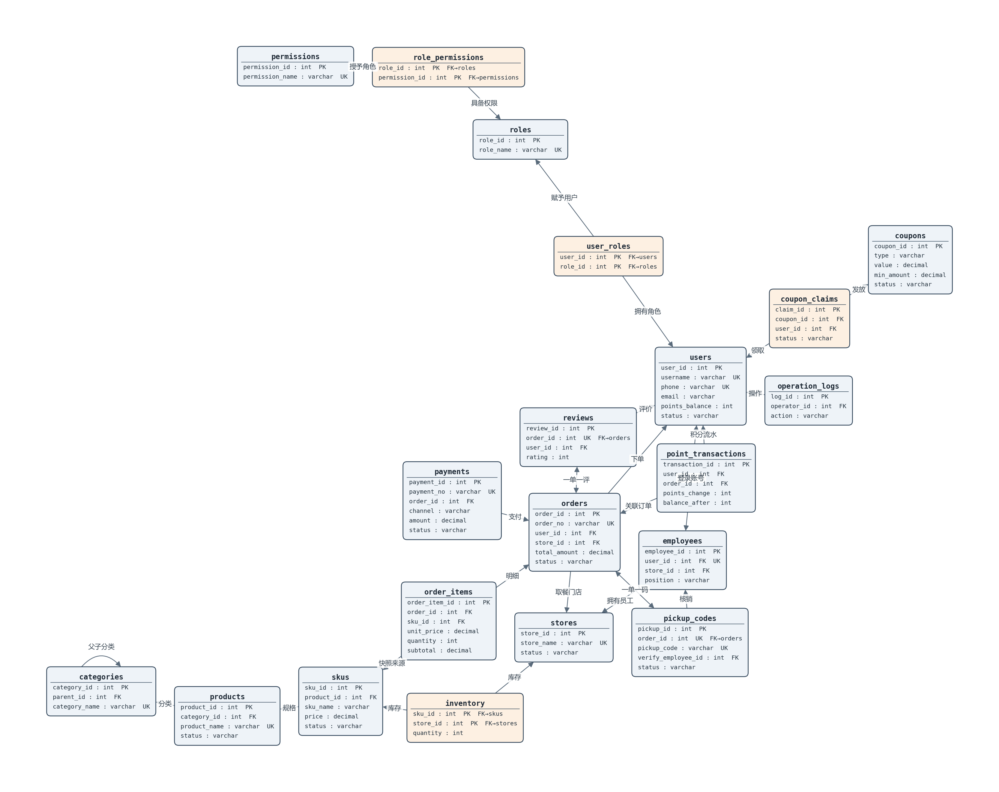

# 校园咖啡店线上点单自取系统（数据库课程项目）

> 数据库系统原理实验 · **v1.0**（第 1—9 周）：数据库原型 + Web 应用。
> v0.1（第 1—4 周）完成建库、装载、增删改查、视图、完整性与授权；第 5—6 周完成 ER、函数依赖与规范化、迁移与回归；第 7—9 周在 v1.0 库上做出分层 Web 应用。

## 项目范围

一个校园咖啡店线上点单自取系统：顾客在线下单并支付，店员接单制作、核销取餐码，店长管理商品/库存/优惠并审批退款，系统管理员管理账号与权限。业务覆盖「顾客 → 完成交易 → 售后」的主链路，并保留会员积分、优惠券、评价等经营数据。会员 = 已注册顾客，积分随账号存、留流水。

v1.0 应用只覆盖任务要求的商品、库存、订单与明细：顾客浏览与下单，店员处理订单与库存，店长维护商品；支付为模拟动作，优惠券、评价、积分与系统管理不在应用范围内。

## 设计分析（第 5—6 周）

### 1. ER 图



实体、联系与基数见 [`week5.ER/ER图.md`](week5.ER/ER图.md)：20 张表与 ER 实体一一对应，没有 ER 与表结构不一致的地方。

### 2. 函数依赖与更新异常

- 关键决定关系：`product_id → category_id`，`category_id → category_name` 落在 `categories`，`products` 不冗余分类名；`order_items` 保留 `product_name`/`sku_name`/`unit_price` 快照，商品改名/改价不回写历史订单；`employees.user_id`、`products.product_name` 作为候选码。
- 更新异常：分类名单点存储，改分类名只改一行（避免修改异常）；分类可以先于商品插入（避免插入异常）；删除商品不连带丢失分类信息（避免删除异常）。`order_items` 快照与 `orders.total_amount` 是两处有意冗余，分别由「下单一次性快照」和「订单总额=明细合计」核对维护。
- 逐表候选码、函数依赖、插入/修改/删除异常与范式判断见 [`week6.关系属性码分析.md`](week6.关系属性码分析.md)。

### 3. 范式结论与分解方案

- 20 张表满足 1NF/2NF/3NF（并确认 BCNF/4NF），不拆表；仅两处修正：`employees.user_id` 可空→非空，`products.product_name` 补唯一约束。
- 无表拆分，无损连接与依赖保持自然成立；`order_items` 快照与 `orders.total_amount` 的冗余维护方式见上。

## 环境

- 数据库：Microsoft SQL Server，示例库名 `CampusCoffee`，排序规则 `Chinese_PRC_CI_AS`
- 脚本：T-SQL；`CREATE LOGIN` 需 sysadmin，其余脚本建议以 `sa` / `db_owner` 执行
- 应用：Python 3.13、Flask 3.1、pyodbc 5.3、ODBC Driver 18 for SQL Server
- 应用账号：`login_app` / `App@Campus2026`（由 `08_app_db.sql` 创建，`db_app` 角色，最小权限）

## 目录结构

```text
DataBase-Project/
├── 01—08、11            建库/数据/CRUD/查询/视图/约束/权限/应用账号/删库
├── 09_migration.sql     第六周迁移（编号版）
├── migration.sql        同上，按阶段作业清单命名，二者择一执行
├── 10_regression.sql    第六周回归（编号版）
├── regression.sql       同上，按阶段作业清单命名，二者择一执行
├── week5.ER/            ER 图与生成脚本
├── week6.v0.1基线/      v0.1 副本（01+02）与迁移前基准
├── week6.关系属性码分析.md
├── week7-9：Web应用开发.md
├── week7-9/截图/        应用流程截图
├── app/                 Flask 应用（web/ services/ dal/ templates/ static/）
├── tests/               pytest 集成测试
├── run.py requirements.txt .env.example
├── ai_log/              v0.1、v1.0 的 AI 使用记录
├── 阶段报告/            v0.1、v1.0 的阶段报告
└── README/分工表
```

| 路径 | 说明 |
| --- | --- |
| `01_create_database.sql` | 建库 + 20 张表 + 主外键/唯一/检查约束（v1.0 结构） |
| `02_insert_sample_data.sql` | 清空并装载样例数据（唯一数据源，可重复执行） |
| `03_crud.sql` | 增删改演示，每个操作后附 SELECT 核对 |
| `04_query.sql` | 多表连接 + 统计查询（聚合 / GROUP BY / HAVING / 子查询） |
| `05_view.sql` | 7 个统计视图，并逐个验证 |
| `06_constraint.sql` | 补充完整性约束 + 合法/非法数据验证 |
| `07_role.sql` | 数据库角色 + 最小权限授权 + 越权失败验证 |
| `08_app_db.sql` | Web 应用的数据库账号与最小授权（`login_app`/`u_app`/`db_app`）+ 演示密码 |
| `09_migration.sql` | 第六周迁移（编号版）：v0.1 副本 → v1.0 目标结构 |
| `10_regression.sql` | 第六周回归测试（编号版） |
| `migration.sql` / `regression.sql` | 按阶段作业清单命名的迁移/回归脚本，内容与 09/10 相同，二者择一执行 |
| `11_drop_database.sql` | 删除 `CampusCoffee`（重建或切换库时用） |
| `week6.v0.1基线/` | v0.1 数据库副本（01+02）与迁移前基准 |
| `week6.关系属性码分析.md` | 函数依赖 / 候选码 / 更新异常 / 范式 / 分解与冗余取舍 |
| `week5.ER/` | ER 图（`ER图.png`）与生成脚本 |
| `week7-9：Web应用开发.md` | 应用分层、角色、功能 I/O、事务、错误码与测试说明 |
| `app/` | Flask 应用：`web/` 页面与 API、`services/` 业务、`dal/` 数据访问 |
| `tests/` | pytest 集成测试 |
| `run.py`、`requirements.txt`、`.env.example` | 应用入口、依赖、连接配置模板 |
| `week7-9/截图/` | 应用流程与测试截图（验收证据） |
| `验证结果截图/` | v0.1 阶段的验证截图 |
| `ai_log/` | v0.1、v1.0 的 AI 使用记录 |
| `阶段报告/` | v0.1、v1.0 的阶段报告 |
| `README.md`、`组内分工表.md` | 提交文档 |

## 数据库准备

### 路径 A：空库重建 v1.0（推荐用于复现）

`01` → `02` → `06` → `07` → `08`

- `01`/`02` 已经是 v1.0 结构（`employees.user_id` 非空、`products.product_name` 唯一）与配套样例数据；
- `07` 的 `CREATE LOGIN` 需要 sysadmin；
- `08` 建应用账号并补演示密码，之后应用才能登录。

### 路径 B：v0.1 副本 + 迁移 + 回归（第六周验收）

`week6.v0.1基线/01` → `week6.v0.1基线/02` → `09_migration.sql` → `08_app_db.sql` → `10_regression.sql`

- `09` 只允许在 v0.1 副本上运行：开头会检查 `employees.user_id` 可空，不是 v0.1 会中止；
- `09` 整体事务 + `XACT_ABORT`，失败回滚；重跑前按 `week6.v0.1基线/README.md` 重建副本；
- `10` 的 Part 8 越权用例需要先跑 `08`，否则打印「跳过」；
- `11` 用于删库重建；
- 迁移只覆盖 v0.1→v1.0 的结构/数据差异；若要与空库重建结果完全一致，迁移后补跑 `06_constraint.sql`（只跑一次）和 `07_role.sql`（库角色演示）。

## 启动应用

```bash
# 1. 复制配置模板，按本机实例与账号修改
copy .env.example .env

# 2. 安装依赖（本机已装可跳过）
pip install -r requirements.txt

# 3. 启动
python run.py
```

浏览器打开 `http://127.0.0.1:5000`。演示账号（密码统一 `Campus@2026`）：

| 账号 | 角色 | 用途 |
| --- | --- | --- |
| `alice` | 顾客 | 浏览商品、下单、改明细、支付、取消 |
| `bob` | 店员 | 处理订单、推进状态、调整库存 |
| `carol` | 店长 | 商品与规格维护、库存调整、订单查看 |
| `admin` / `wangqiang` | 系统管理员 / 店员 | 可选演示 |

## 操作手册

### 1. 登录

启动后打开 `http://127.0.0.1:5000`，用演示账号登录，密码统一 `Campus@2026`。登录页见 [登录界面](week7-9/截图/登录界面.jpg)。

### 2. 顾客（alice）

1. 商品页浏览商品与规格；
2. 下单页选门店、规格、数量，可选取餐时间与备注，提交；
3. 我的订单里查看详情；待支付订单可以改数量、加一份、删明细、支付（模拟）或取消；
4. 操作截图见 [顾客下单](week7-9/截图/顾客下单.jpg)。

### 3. 店员（bob）

1. 订单列表查看全部订单，进详情按 已支付 → 制作中 → 待取餐 → 已完成 推进；
2. 库存页按门店查询、改数量保存；
3. 操作截图见 [店员推进订单](week7-9/截图/店员推进订单.jpg)。

### 4. 店长（carol）

1. 商品页新增/编辑商品，进详情维护规格；
2. 库存页调整数量；
3. 订单只读；删除仍有规格或历史引用的商品会返回约束冲突提示；
4. 操作截图见 [店长调整库存](week7-9/截图/店长调整库存.jpg)。

### 5. 权限与错误

页面按角色隐藏按钮，后端业务层再校验一次；越权 403、未登录 401、参数错误 400。错误只显示统一提示，SQL、堆栈与连接信息只写 `logs/app.log`。

## 测试

```bash
# 先重跑 02 回到基线，再跑测试
python -m pytest tests -q
```

覆盖：登录成功/失败、未登录、越权、参数错误；商品新增/编辑/删除与约束冲突；库存查询/调整；下单扣库存、明细增改删、支付、取消回补、非法状态转移、库存不足回滚；顾客只能看自己的订单；数据库连接失败（模拟）；注入串参数化。测试会写数据，跑完可再重跑 `02` 复位。

## 验证要点

| 脚本/入口 | 应该看到什么 |
| --- | --- |
| `02_insert_sample_data.sql` | 行数核对符合注释；订单总额=明细合计、积分余额=流水末笔两组核对返回 0 行 |
| `06_constraint.sql` | 正例插入成功；反例逐条被拒绝；行数不变 |
| `07_role.sql` | 正常操作成功；越权操作报消息 229 |
| `08_app_db.sql` | 输出 `db_app` 的授权清单 |
| `09_migration.sql` | 基线检查通过；迁移前后订单明细/销量/库存一致；`users` 4→5、`user_roles` 4→5，其余行数不变 |
| `10_regression.sql` | 各 Part 预期一致；含 PASS 行；越权用例报 229 |
| `tests/` | pytest 全部通过 |
| 应用 | 三角色流程可走通；越权/未登录/参数错误返回统一提示，SQL 只进日志 |

## 结果索引

| 结果项 | 位置 |
| --- | --- |
| ER 图 | `week5.ER/ER图.png` |
| 规范化分析 | `week6.关系属性码分析.md` |
| 迁移前基准与迁移说明 | `week6.v0.1基线/README.md`、`09_migration.sql` Part 0 |
| 迁移结果 | v1.0 阶段报告第二节（迁移与回归）：迁移前后订单明细/销量/库存一致，运行正常 |
| 回归结果 | v1.0 阶段报告第二节；`10_regression.sql` 运行正常（含 PASS 行） |
| 应用流程 | `week7-9/截图/`（登录、顾客下单、店员推进、店长库存，流程示意） |
| 应用测试 | v1.0 阶段报告第四节（测试与验收），pytest 覆盖，运行正常 |
| v0.1 验证截图 | `验证结果截图/` |

## 提交内容对应（本次 v1.0，第 5—9 周）

| 提交项 | 本次提交 | 历史/支撑 |
| --- | --- | --- |
| README | 本文件 | — |
| 实现代码 | `01`—`11`、`migration.sql`、`regression.sql`、`08_app_db.sql`、`app/`、`tests/`、`run.py`、`requirements.txt`、`week6.v0.1基线/` | `03`—`07` 的 v0.1 脚本 |
| 结果 | `week5.ER/ER图.png`、`week6.关系属性码分析.md`、`week7-9/截图/`、迁移/回归/测试结论（v1.0 阶段报告第二、四节） | `验证结果截图/` |
| 阶段报告 | `阶段报告/v1.0_第5-9周.md` | `阶段报告/v0.1_第1-4周.md` |
| AI 使用记录 | `ai_log/v1.0_第5-9周.md` | `ai_log/v0.1_第1-4周.md` |
| 组内分工 | `组内分工表.md` | — |

## 文档索引

- 第 1—2 周：[`week1：项目设计.md`](week1：项目设计.md)、[`week2：关系模式设计.md`](week2：关系模式设计.md)
- 第 5 周：[`week5.ER/ER图.md`](week5.ER/ER图.md)
- 第 6 周：[`week6.关系属性码分析.md`](week6.关系属性码分析.md)、[`week6.v0.1基线/README.md`](week6.v0.1基线/README.md)
- 第 7—9 周：[`week7-9：Web应用开发.md`](week7-9：Web应用开发.md)

## 常见问题

- **连不上数据库**：先确认实例名（默认 `.\SQLEXPRESS`）、`CampusCoffee` 是否存在、SQL Server 是否启用 SQL 登录；连接信息都在 `.env`。
- **应用登录失败**：确认已执行 `01`→`02`→`08`，且 `.env` 的账号密码与 `08` 一致。
- **迁移脚本报「基线不符」**：`09` 只能在 v0.1 副本上跑；按 `week6.v0.1基线/README.md` 重建。
- **测试失败**：先重跑 `02` 回到基线；测试会创建订单与临时商品。
- **重复执行**：`02` 可反复执行；`03` 自还原；`06` 重复执行前需按文末重置段处理；`07`、`08` 有存在性保护；`09` 不可重复执行。
