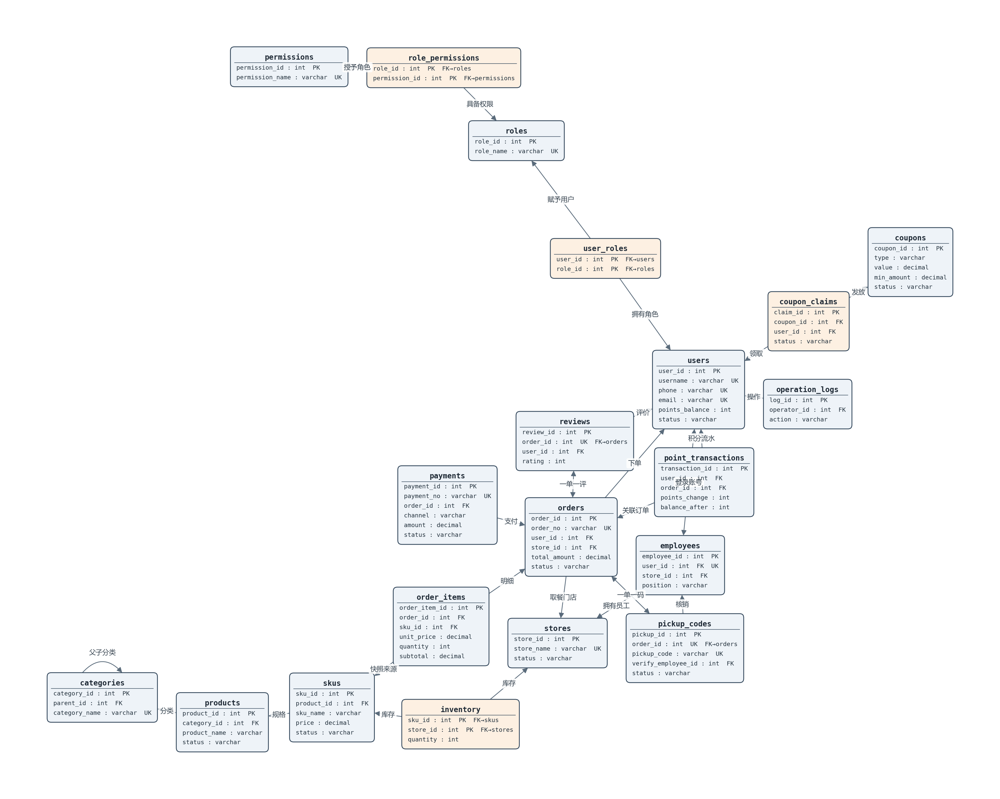

# 校园咖啡店线上点单自取系统 — ER 图（箭头记号）

> 依据 `01_create_database.sql`（20 张表 DDL）与 `关系表说明.md` 生成。
> 生成方式：`python ER图.py`（matplotlib + networkx），输出 `ER图.png`。

## 记号约定

关系两端只有 **箭头 / 无箭头** 两种形式：

| 记号 | 含义 |
| --- | --- |
| `→`（箭头） | **一（1）** |
| （无线） | **多（N）** |

- **1 : 1** —— 两端都打箭头
- **1 : N / N : 1** —— 在“一”的实体一端打箭头
- **M : N** —— 不打箭头，直接一根线连接
- **严格非一数量**（如 3 : 2）—— 在对应实体的接口旁写数字

字段注释：**PK** = 主码，**FK** = 外码，**UK** = 候选码（唯一）。
4 张“仅用于 join 的关联实体”单独着色：`user_roles`、`role_permissions`、`inventory`、`coupon_claims`。

## 基数速查

| 关系 | 基数 | 说明 |
| --- | --- | --- |
| users ↔ roles（经 user_roles） | M : N | 关联实体 |
| roles ↔ permissions（经 role_permissions） | M : N | 关联实体 |
| users ↔ employees | 0..1 : 0..1 | user_id 唯一可空 |
| stores → employees | 1 : N | |
| categories → categories | 0..1 : N | 自引用 parent_id |
| categories → products → skus | 1 : N : N | |
| skus ↔ stores（经 inventory） | M : N | 关联实体，带 quantity |
| users / stores → orders | 1 : N | |
| orders → order_items / payments | 1 : N | |
| skus → order_items | 0..1 : N | sku_id 可空（快照） |
| orders → pickup_codes | 1 : 0..1 | 一单一码 |
| employees → pickup_codes | 0..1 : N | 核销人 |
| orders → reviews | 1 : 0..1 | 一单一评 |
| coupons ↔ users（经 coupon_claims） | M : N | 关联实体 |
| users → point_transactions / operation_logs | 1 : N | |
